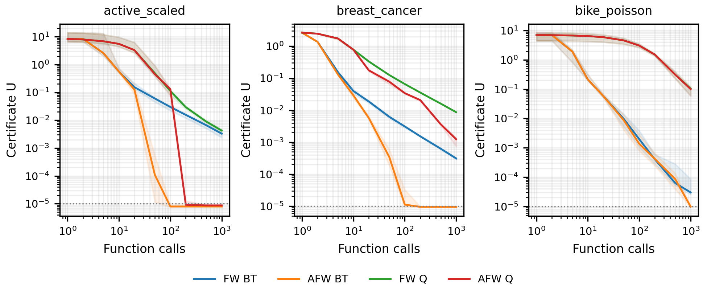

# Away-step FW при кривизне, зависящей от значения функции

280 запусков, семейств 7, seed 10. Все методы начинают из одной исходной вершины, без обязательного начального LMO-перехода. FW_BT/AFW_BT используют обычное деление оценки пополам и удвоение при отказе, начальная оценка 1. FW_Q/AFW_Q получают аналитические H0,H1 и используют короткий квадратичный шаг по текущему U. Это существующие схемы FW/AFW; новым алгоритмом AFW не объявляется.

Допуск U≤1e-05, ограничение 1000 обновлений. В U входит полный FW-gap, независимо от выбранного направления. Все пробы f оплачены, принятое значение повторно используется. Число градиентов и полных LMO равно N+1. У AFW отдельно записаны away_scans и active_atom_scores. Обновление и восстановление активных весов также требуют работы, поэтому одни счётчики LMO не равны полному времени. Время — по одному запуску экземпляра, без доказанного преимущества по wall-clock.

Префиксы при отдельных бюджетах функции/градиента/LMO вычислены из полного журнала до его прореживания. Другие типы затрат при таком срезе не ограничиваются. В полном протоколе бюджет 1000 достигается до внешнего ограничения у незавершённых запусков. Медианы к концу включают ограниченные бюджетом запуски, поэтому даны и числа успехов.

## interior

| Метод | Успехи к концу | f | ∇f / LMO | U при ≤1000 f | Успехи при ≤1000 f | Удаления | Оценки активных атомов |
| --- | ---: | ---: | ---: | ---: | ---: | ---: | ---: |
| FW_BT | 10/10 | 168.5 | 86.0 | 9.338e-06 | 10/10 | — | — |
| AFW_BT | 10/10 | 147.5 | 75.5 | 8.965e-06 | 10/10 | 0.0 | 356.0 |
| FW_Q | 10/10 | 138.0 | 138.0 | 9.414e-06 | 10/10 | — | — |
| AFW_Q | 10/10 | 119.5 | 119.5 | 9.595e-06 | 10/10 | 0.0 | 569.0 |

## boundary

| Метод | Успехи к концу | f | ∇f / LMO | U при ≤1000 f | Успехи при ≤1000 f | Удаления | Оценки активных атомов |
| --- | ---: | ---: | ---: | ---: | ---: | ---: | ---: |
| FW_BT | 0/10 | 1999.0 | 1001.0 | 2.238e-04 | 0/10 | — | — |
| AFW_BT | 10/10 | 112.0 | 57.5 | 6.248e-06 | 10/10 | 0.0 | 269.5 |
| FW_Q | 0/10 | 1001.0 | 1001.0 | 1.862e-04 | 0/10 | — | — |
| AFW_Q | 10/10 | 94.0 | 94.0 | 8.271e-06 | 10/10 | 0.0 | 442.0 |

## active

| Метод | Успехи к концу | f | ∇f / LMO | U при ≤1000 f | Успехи при ≤1000 f | Удаления | Оценки активных атомов |
| --- | ---: | ---: | ---: | ---: | ---: | ---: | ---: |
| FW_BT | 0/10 | 1998.5 | 1001.0 | 4.401e-04 | 0/10 | — | — |
| AFW_BT | 10/10 | 27.0 | 15.0 | 4.943e-06 | 10/10 | 1.0 | 39.0 |
| FW_Q | 0/10 | 1001.0 | 1001.0 | 3.646e-04 | 0/10 | — | — |
| AFW_Q | 10/10 | 24.0 | 24.0 | 7.845e-06 | 10/10 | 1.0 | 68.5 |

## active_scaled

| Метод | Успехи к концу | f | ∇f / LMO | U при ≤1000 f | Успехи при ≤1000 f | Удаления | Оценки активных атомов |
| --- | ---: | ---: | ---: | ---: | ---: | ---: | ---: |
| FW_BT | 0/10 | 2002.0 | 1001.0 | 3.284e-03 | 0/10 | — | — |
| AFW_BT | 10/10 | 56.5 | 28.5 | 7.940e-06 | 10/10 | 2.0 | 98.5 |
| FW_Q | 0/10 | 1001.0 | 1001.0 | 4.256e-03 | 0/10 | — | — |
| AFW_Q | 10/10 | 160.5 | 160.5 | 8.667e-06 | 10/10 | 3.0 | 647.0 |

## active_highdim

| Метод | Успехи к концу | f | ∇f / LMO | U при ≤1000 f | Успехи при ≤1000 f | Удаления | Оценки активных атомов |
| --- | ---: | ---: | ---: | ---: | ---: | ---: | ---: |
| FW_BT | 0/10 | 1999.0 | 1001.0 | 4.996e-04 | 0/10 | — | — |
| AFW_BT | 10/10 | 31.0 | 17.0 | 6.566e-06 | 10/10 | 1.0 | 45.5 |
| FW_Q | 0/10 | 1001.0 | 1001.0 | 4.659e-04 | 0/10 | — | — |
| AFW_Q | 10/10 | 36.0 | 36.0 | 8.961e-06 | 10/10 | 1.0 | 111.5 |

## breast_cancer

| Метод | Успехи к концу | f | ∇f / LMO | U при ≤1000 f | Успехи при ≤1000 f | Удаления | Оценки активных атомов |
| --- | ---: | ---: | ---: | ---: | ---: | ---: | ---: |
| FW_BT | 0/10 | 1997.0 | 1001.0 | 3.106e-04 | 0/10 | — | — |
| AFW_BT | 10/10 | 103.5 | 53.5 | 9.525e-06 | 10/10 | 2.0 | 262.0 |
| FW_Q | 0/10 | 1001.0 | 1001.0 | 8.675e-03 | 0/10 | — | — |
| AFW_Q | 0/10 | 1001.0 | 1001.0 | 1.238e-03 | 0/10 | 2.0 | 5098.0 |

## bike_poisson

| Метод | Успехи к концу | f | ∇f / LMO | U при ≤1000 f | Успехи при ≤1000 f | Удаления | Оценки активных атомов |
| --- | ---: | ---: | ---: | ---: | ---: | ---: | ---: |
| FW_BT | 8/10 | 1789.0 | 894.5 | 3.007e-05 | 1/10 | — | — |
| AFW_BT | 10/10 | 877.5 | 439.0 | 9.884e-06 | 6/10 | 0.0 | 3953.0 |
| FW_Q | 0/10 | 1001.0 | 1001.0 | 1.044e-01 | 0/10 | — | — |
| AFW_Q | 0/10 | 1001.0 | 1001.0 | 1.002e-01 | 0/10 | 0.0 | 3428.5 |

## Интерпретация полного протокола

AFW_BT достигает допуска на всех 70 экземплярах. На active_scaled медиана 56.5 значений функции и 28.5 градиентов; обычный FW_BT не сертифицирует ни один из десяти запусков. На breast_cancer — 10/10 успехов при 103.5 значениях функции у AFW_BT против 0/10 у FW_BT. На bike_poisson к концу AFW_BT даёт 10/10, но при 1000 значений функции — только 6/10; это различие нельзя скрывать. FW_BT при том же фиксированном бюджете даёт 1/10.

AFW_Q всё ещё не достигает допуска на обеих реальных регрессиях за 1000 обновлений: аналитические константы консервативны. Поэтому переход к away-направлениям сам по себе не делает любой шаг быстрым. На interior разница умеренная. Результаты относятся к этим экземплярам и не устанавливают превосходство над всеми FW-вариантами.

Два FW-baseline повторяют 140 прежних траекторий; 140 AFW-запусков дополняют сравнение на тех же 70 задачах. Независимых новых наборов данных нет. Все 70 полных траекторий AFW_BT проверены по принятым кривизнам, фазовым границам, счёту удалений, точному телескопическому равенству проб и переходу от ошибки к сертификату. Неизвестная пирамидальная ширина не подгоняется по траекториям; универсальная проверка геометрической теоремы тестами не заявляется. Численные проверки не заменяют доказательство и аудит приоритета.

## Рисунок

[Векторный PDF](away_comparison.pdf). Медиана и IQR; значения взяты из действительных префиксов. Между отмеченными бюджетами линии служат визуализации; завершённые значения сохраняются.
