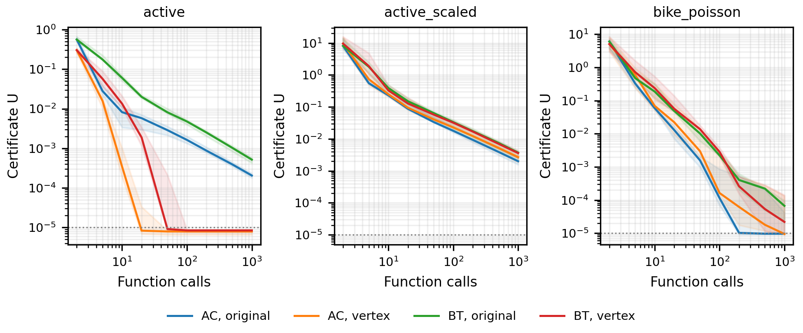

# Контроль начальной точки и правила адаптации

280 запусков: четыре условия, семейств 7, seed 10. Использованы прежние семейства задач. Ячейка AC_vertex воспроизводит прежний AC-FW; на полном протоколе все 70 её запусков совпали с прежними результатами. Три остальных условия — контролируемые варианты, а не заявленные алгоритмы авторов AC-FW.

В каждом условии оплачены f, градиент и LMO в исходной точке x и в новой вершине z=LMO(grad f(x)): по два вызова каждого оракула. Оба линейных нижних ограничения и секущая оценка кривизны доступны всем. AC использует эту оценку первой; у BT начальное хранимое значение вдвое больше, чтобы после деления пополам первая проба совпала. BT затем делит оценку пополам и удваивает при отказе. AC использует затухание по (6) arXiv:2605.15512v2 с delta=1. Эти настройки фиксированы без подбора по задачам.

Допуск U≤1e-05, ограничение 1000 внешних проб. Отказ AC оплачивается и расходует внешнюю итерацию; BT проверяет несколько проб внутри неё. Отдельный budget.csv содержит последний полностью доступный сертификат при заданном бюджете каждого оракула, остальные типы вызовов не ограничиваются. Это точные префиксы полного журнала, а не интерполяция по сохранённому trace.csv. После достижения допуска значение сохраняется. На рисунке при больших бюджетах сохраняется и последнее значение ограниченных числом итераций запусков; основной срез по f использует бюджет 1000, который достигается до внешнего ограничения в любом незавершённом запуске.

## interior

| Условие | Успехи к концу | Медиана f | Медиана ∇f | U при ≤1000 f | Успехи при ≤1000 f | U при ≤1000 ∇f | Успехи при ≤1000 ∇f |
| --- | ---: | ---: | ---: | ---: | ---: | ---: | ---: |
| AC_original | 10/10 | 54.5 | 54.5 | 9.469e-06 | 10/10 | 9.469e-06 | 10/10 |
| AC_vertex | 10/10 | 54.5 | 54.5 | 9.533e-06 | 10/10 | 9.533e-06 | 10/10 |
| BT_original | 10/10 | 186.0 | 94.0 | 9.602e-06 | 10/10 | 9.602e-06 | 10/10 |
| BT_vertex | 10/10 | 192.0 | 97.0 | 9.132e-06 | 10/10 | 9.132e-06 | 10/10 |

## boundary

| Условие | Успехи к концу | Медиана f | Медиана ∇f | U при ≤1000 f | Успехи при ≤1000 f | U при ≤1000 ∇f | Успехи при ≤1000 ∇f |
| --- | ---: | ---: | ---: | ---: | ---: | ---: | ---: |
| AC_original | 0/10 | 1002.0 | 1002.0 | 1.062e-04 | 0/10 | 1.062e-04 | 0/10 |
| AC_vertex | 0/10 | 1002.0 | 1002.0 | 1.062e-04 | 0/10 | 1.062e-04 | 0/10 |
| BT_original | 0/10 | 2002.0 | 1002.0 | 2.733e-04 | 0/10 | 1.364e-04 | 0/10 |
| BT_vertex | 0/10 | 2002.0 | 1002.0 | 2.730e-04 | 0/10 | 1.364e-04 | 0/10 |

## active

| Условие | Успехи к концу | Медиана f | Медиана ∇f | U при ≤1000 f | Успехи при ≤1000 f | U при ≤1000 ∇f | Успехи при ≤1000 ∇f |
| --- | ---: | ---: | ---: | ---: | ---: | ---: | ---: |
| AC_original | 1/10 | 1002.0 | 1002.0 | 2.055e-04 | 1/10 | 2.055e-04 | 1/10 |
| AC_vertex | 10/10 | 18.5 | 18.5 | 7.934e-06 | 10/10 | 7.934e-06 | 10/10 |
| BT_original | 0/10 | 2001.0 | 1002.0 | 5.185e-04 | 0/10 | 2.608e-04 | 0/10 |
| BT_vertex | 10/10 | 48.0 | 25.5 | 8.436e-06 | 10/10 | 8.436e-06 | 10/10 |

## active_scaled

| Условие | Успехи к концу | Медиана f | Медиана ∇f | U при ≤1000 f | Успехи при ≤1000 f | U при ≤1000 ∇f | Успехи при ≤1000 ∇f |
| --- | ---: | ---: | ---: | ---: | ---: | ---: | ---: |
| AC_original | 0/10 | 1002.0 | 1002.0 | 2.004e-03 | 0/10 | 2.004e-03 | 0/10 |
| AC_vertex | 0/10 | 1002.0 | 1002.0 | 2.679e-03 | 0/10 | 2.679e-03 | 0/10 |
| BT_original | 0/10 | 2000.0 | 1002.0 | 3.716e-03 | 0/10 | 1.857e-03 | 0/10 |
| BT_vertex | 0/10 | 2000.0 | 1002.0 | 3.598e-03 | 0/10 | 1.837e-03 | 0/10 |

## active_highdim

| Условие | Успехи к концу | Медиана f | Медиана ∇f | U при ≤1000 f | Успехи при ≤1000 f | U при ≤1000 ∇f | Успехи при ≤1000 ∇f |
| --- | ---: | ---: | ---: | ---: | ---: | ---: | ---: |
| AC_original | 6/10 | 22.0 | 22.0 | 9.653e-06 | 6/10 | 9.653e-06 | 6/10 |
| AC_vertex | 8/10 | 17.0 | 17.0 | 8.353e-06 | 8/10 | 8.353e-06 | 8/10 |
| BT_original | 2/10 | 2001.0 | 1002.0 | 4.531e-04 | 2/10 | 2.274e-04 | 2/10 |
| BT_vertex | 8/10 | 66.0 | 34.0 | 8.057e-06 | 8/10 | 8.057e-06 | 8/10 |

## breast_cancer

| Условие | Успехи к концу | Медиана f | Медиана ∇f | U при ≤1000 f | Успехи при ≤1000 f | U при ≤1000 ∇f | Успехи при ≤1000 ∇f |
| --- | ---: | ---: | ---: | ---: | ---: | ---: | ---: |
| AC_original | 0/10 | 1002.0 | 1002.0 | 3.402e-04 | 0/10 | 3.402e-04 | 0/10 |
| AC_vertex | 0/10 | 1002.0 | 1002.0 | 3.386e-04 | 0/10 | 3.386e-04 | 0/10 |
| BT_original | 0/10 | 2000.0 | 1002.0 | 2.604e-04 | 0/10 | 1.355e-04 | 0/10 |
| BT_vertex | 0/10 | 1999.5 | 1002.0 | 2.603e-04 | 0/10 | 1.355e-04 | 0/10 |

## bike_poisson

| Условие | Успехи к концу | Медиана f | Медиана ∇f | U при ≤1000 f | Успехи при ≤1000 f | U при ≤1000 ∇f | Успехи при ≤1000 ∇f |
| --- | ---: | ---: | ---: | ---: | ---: | ---: | ---: |
| AC_original | 6/10 | 194.0 | 194.0 | 9.722e-06 | 6/10 | 9.722e-06 | 6/10 |
| AC_vertex | 7/10 | 639.0 | 639.0 | 9.535e-06 | 7/10 | 9.535e-06 | 7/10 |
| BT_original | 6/10 | 1788.0 | 895.5 | 6.720e-05 | 2/10 | 9.936e-06 | 6/10 |
| BT_vertex | 5/10 | 1470.0 | 738.5 | 2.200e-05 | 5/10 | 1.114e-05 | 5/10 |

## Интерпретация полного протокола (семь семейств, десять seed)

На active переход к новой вершине меняет успехи AC с 1/10 на 10/10 и BT с 0/10 на 10/10 при бюджете 1000 значений функции. Поэтому прежние 10/10 AC-FW против 0–1/10 обычных вариантов не выделяли вклад последующего правила адаптации. Это конкретный результат для этих экземпляров, а не общий закон о выборе стартовой вершины.

На bike_poisson успехи и распределение затрат меняются неодинаково. При бюджете 1000 f у AC исходная/новая точка дают 6/10 и 7/10, у BT — 2/10 и 5/10. При бюджете 1000 ∇f BT из исходной точки даёт 6/10, как AC. Порядок методов зависит от стоимости оракула; фиксированная сумма затрат с произвольными весами не используется.

paired_comparisons.csv содержит 84 описательных сравнения при бюджете 1000: медиану индивидуальных парных отношений сертификатов и percentile-bootstrap интервалы (seed 20261015, 10000 повторов). Поправки на множественные сравнения нет. На уже завершённых запусках сертификат находится около допуска; отношение таких сертификатов не является коэффициентом ускорения. На Bike Sharing seed меняет старт одного обучающего функционала, а не независимый набор данных.

Геометрия трёх активных семейств проверяется отдельно: face_summary.csv и face_trace.csv используют эталонную опору только после завершения оптимизации. Линейное тождество σ(x+α(s−x))=(1−α)σ(x)+ασ(s), σ(x)=R−sign(x*)ᵀx, объясняет сохранение массы вне оптимальной грани при неполных шагах. Эта геометрия известна в анализе FW; новым механизмом ускорения она не объявляется.

## Рисунок для статьи

[Векторный PDF](initialization_publication.pdf). Линии между указанными бюджетами служат только для визуализации; значения в budget.csv взяты из действительных префиксов.
